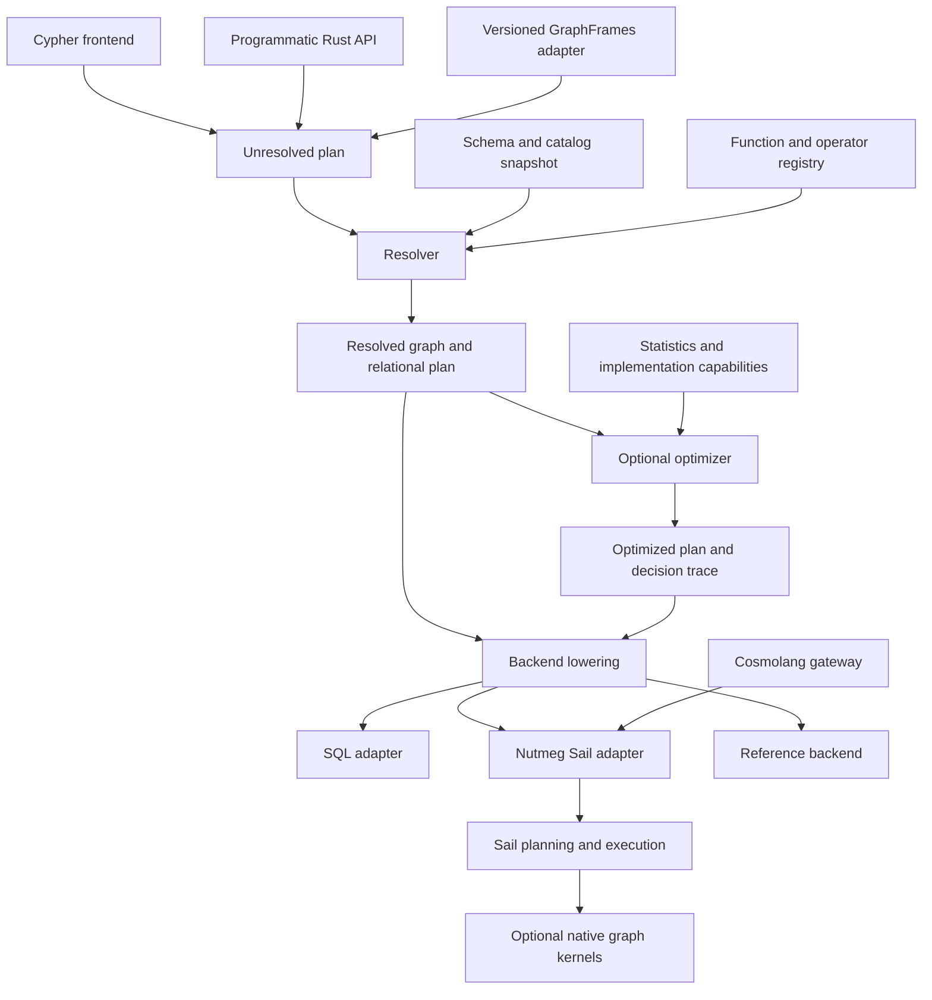

# A graph model that several engines can implement

Grustic supplies reusable graph schema, query and algorithm contracts to Rust
applications. Nutmeg assembles them with Sail's execution services. A caller
should be able to use schema reasoning or planning without loading a parser,
opening files, starting threads or importing DataFusion.

**Proposal:** retain the separate plan phases agreed with Sem, preserve graph
operations through logical planning, and keep runtime representations in
adapters. This document proposes module responsibilities; it is not a frozen
Rust API or wire format.

## Dependency direction

An intermediate representation, or IR, records what a query means between
compilation stages. A logical plan records operations and semantics. A physical
plan chooses how and where those operations execute.

The arrows show information flow. Rust dependencies point toward contracts:
backends depend on plan types, never on the concrete resolver or optimizer.
The optimized-plan contract can be consumed without linking an optimizer.

| Package or module | Owns | Must not require |
| --- | --- | --- |
| `grustic-types`, `grustic-schema` | Logical values, identities, labels, groups, inheritance and catalog metadata interfaces | Arrow, files, engines, network or executor |
| `grustic-functions` | Signatures, overload selection inputs, null behavior, volatility and semantic function identities | Sail registration or native code loading |
| `grustic-plan`, `grustic-resolved-plan`, `grustic-optimized-plan` | One canonical contract for each phase, extension descriptors and explain data | Parser implementation or backend handles |
| `grustic-cypher`, `grustic-builder` | Language frontend and parser-free construction, respectively | Sail or algorithm execution |
| `grustic-resolver`, `grustic-optimizer` | Replaceable implementations over the contracts above | Required data scans or statistics collection |
| `grustic-backend` | Capability negotiation, lowering interfaces and typed refusals | A default running engine |
| `grustic-kernel-contract`, optional kernels | Algorithm semantics, requirements and resource ownership; concrete algorithms separately | A parser, Spark protocol or global thread pool |
| Nutmeg/Sail adapter | Engine expressions, scans, projections, placement, host resources and physical implementation selection | Core dependencies on this adapter |
| GraphFrames and Cosmolang adapters | Versioned user contracts and transports | Protocol fields embedded in core graph types |

Keep small helper modules inside their owning package until a real independent
consumer justifies extraction. Separate phase contracts remain independently
usable as Sem requested. An umbrella convenience crate must use opt-in features;
its default should not silently pull every adapter.

## Schema, identity and snapshots

A schema group describes one owning vertex or edge population. Labels and
inherited types describe meaning; property keys are ordinary values unless a
catalog declares a key constraint. A storage property bundle is a set of
columns and is a different concept. One edge population may have several
physical adjacency layouts.

Define source identity separately from projection position. An entity reference
needs graph identity, entity kind and an opaque identity in a declared namespace.
A source whose IDs are only group-unique supplies that namespace explicitly.
Cross-group aliases must resolve to the same canonical reference where the
catalog says they name the same entity. Group membership alone must not silently
change identity during a storage-layout change.

The initial fast adapter keeps Int64 source IDs. Other GraphFrames ID domains
use an explicit mapping with declared equality and restoration behavior.
A dense UInt32 index is admitted only when bounds permit it; larger projections
need a wider index or a refusal. Browser IDs remain lossless strings or binary
values across JSON boundaries, including integers beyond JavaScript's exact range.

A catalog snapshot fixes schema revision, graph data revision and identity
mapping. Logical plans retain immutable identifiers, not live engine handles.
The host acquires any runtime lease and refuses an expired or incompatible
snapshot. Caches include these identities, parameters, semantics profile,
implementation version and authorization scope. A fresh schema alone cannot
make old graph data or an old browser view current.

Future LEX/LDBC schema and GraphAr/icebug-disk adapters should be possible
without changing these distinctions. No conformance to their evolving proposals
is claimed by a similar type name.

## Keep semantics before selecting implementations

The resolved plan must be fully typed, including explicit null-only values,
nullable lists/elements, maps and graph-valued expressions. Define map key/value
typing, null-key policy and equality before exposing shortest-path map results.
Checked constructors
establish scope, slot uniqueness, output shape and function binding. Errors
carry source spans when available; programmatic callers receive structured
locations. Deserialization and third-party constructors pass the same checks.

Retain `Expand`, path matching/selection, correlated apply and algorithm calls
as graph-aware operations. Describe direction, path mode, multiplicity, edge
identity, optionality, predicate placement and result requirements explicitly.
For example, reachability can track only visited endpoints, while returning all
TRAIL paths must preserve edge sequences. They cannot share an implementation
by discarding information the query requests.

Lower these operations to joins, indexed adjacency reads, native kernels or
iterative Sail execution after capability selection. Carry order and partition
requirements where correctness needs them. Do not infer physical ordering from
a logical sort that a later materialization may not preserve.

Keep the old SQL adapter as a useful implementation and differential control.
Making SQL the canonical plan would erase graph alternatives too early.
Using DataFusion's plan as the core would instead couple all consumers to its
release cycle. A modest graph-aware IR plus adapters pays an extra translation
cost, which the second-backend test must justify.

## Extension without making every node arbitrary

Use enums for built-in semantics and a versioned extension-node contract for
third parties. An extension supplies children, expressions, output schema,
identity, effects, logical properties, equality/hash behavior and explain data.
Rebuilding it with rewritten children must validate the same invariants.
Unknown nodes remain opaque barriers unless a registered rule understands them.
An unknown wire node is refused before execution.

Separate semantic registration from implementation registration. A function can
exist in the language yet have no implementation for a selected engine. Pure
expansion providers can lower a convenience operation into existing nodes;
physical providers can implement an admitted node in a specific convention.
Neither may silently assert a stronger order, determinism or retry guarantee.

Do not promise a stable serialized Rust enum or a stable Rust trait ABI. In-process
plugins use Rust interfaces compiled together; dynamic native libraries use the
host's separately versioned boundary. These are different compatibility duties.

## Optimization and execution placement

A physical convention states an execution representation and location: relational
Sail batches, indexed adjacency access, or a native local projection, for example.
Conversions such as scanning, gathering and building adjacency are explicit and
costed. Local placement is not a distributed algorithm merely because input
arrived from distributed tables.

Start with deterministic rule phases and bounded join search. Include optional
row/byte counts, degree skew, endpoint/property distinct counts, layout and
partition information, with snapshot provenance and confidence. Unknown cost
stays unknown. Compare feasible plans under memory limits before ranking cost;
record reasons for preserved or rejected alternatives. Keep rule legality
separate from the search policy.

Grustic chooses graph representations and semantics-preserving alternatives.
Sail chooses its physical relational operators, exchanges and tasks. Record
both plans because Sail may change a proposed join tree. Avoid a second global
cost search until measurements show where it improves complete queries.

Kernel requests name algorithm semantics and output contracts separately from
implementation. Requirements include vertex/edge feature alignment, optional
reverse adjacency, memory estimates, host execution and cancellation. Streaming
updates, retractions and incremental algorithms require their own contracts;
a batch algorithm cannot acquire those capabilities by being called in a loop.

## Review and acceptance

The competing design is a thin Cypher-to-Sail library. It is simpler if Sail
is the only consumer, but it does not satisfy the requested composability.
The proposal is justified only if the first implementation demonstrates:

- A schema-only consumer, with no parser or engine dependency.
- A parser-free client and Cypher client producing equivalent admitted plans.
- A reference backend executing the same bounded queries as Sail.
- A third-party operator and function added without editing core built-ins.
- A physical choice between two faithful implementations with a visible
  conversion cost and resource limit.

Approve the phase and extension boundaries before porting dependent code.
Concrete trait signatures and allocation choices belong to the small design
notes attached to the implementation sequence.
